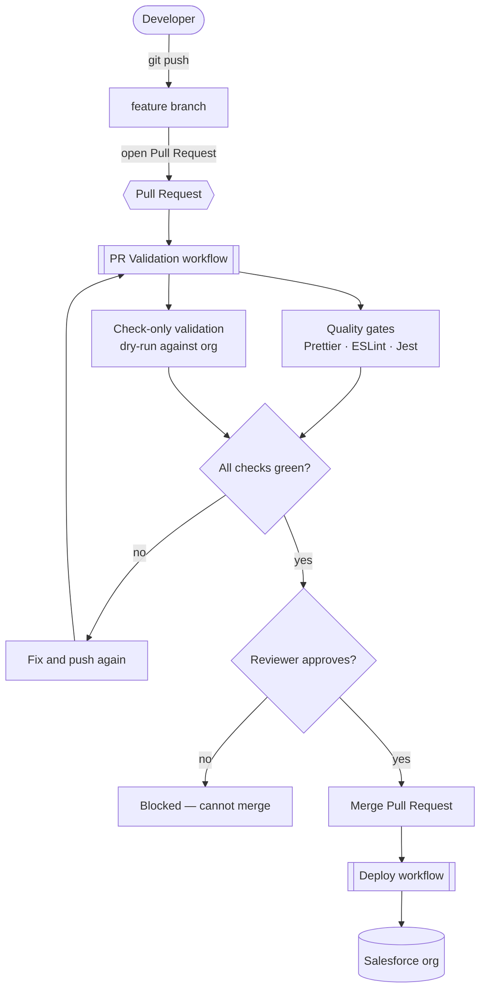
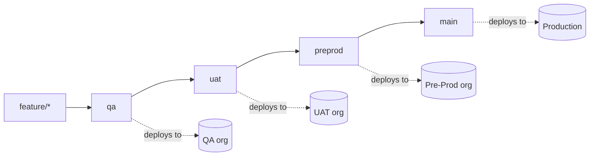
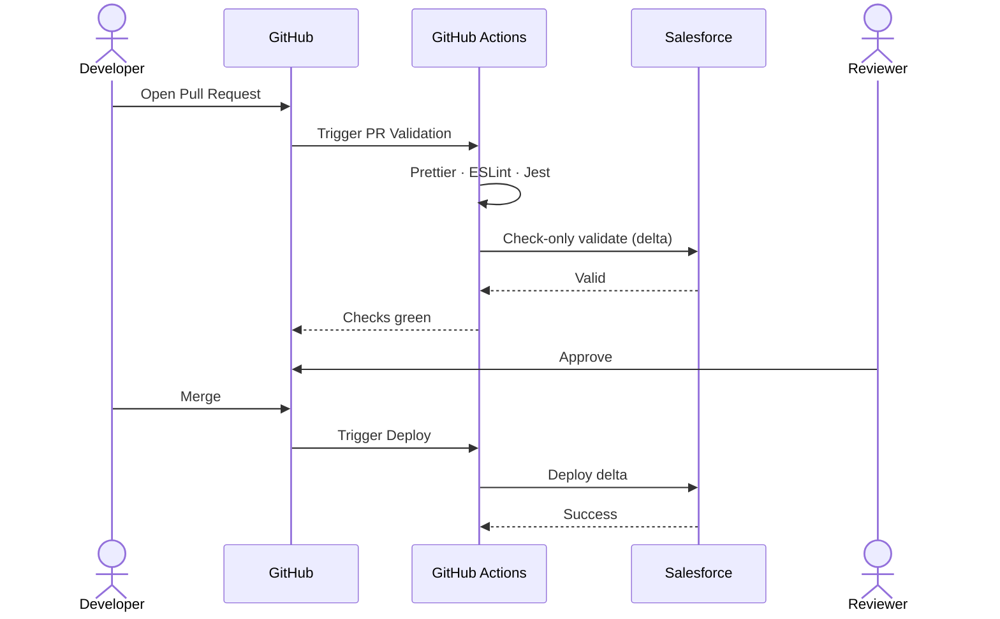

# Salesforce → GitHub Actions CI/CD — A Plain-English Setup Guide

Everything a first-timer needs to wire a Salesforce project to an automated pipeline:
pull-request checks, reviewer approvals, and hands-off deployments to your org — with
every YAML file explained.

**Stack:** Salesforce DX · GitHub Actions · OAuth Client Credentials auth · delta-only deploys · Node 22

---

## Contents

1. [What you're building](#1-what-youre-building)
2. [How it works](#2-how-it-works)
3. [The branch strategy](#3-the-branch-strategy)
4. [Before you start](#4-before-you-start)
5. [Step 1 — Install the tools](#step-1--install-the-tools)
6. [Step 2 — Create the repo & branches](#step-2--create-the-repo--branches)
7. [Step 3 — Set up the Salesforce app](#step-3--set-up-the-salesforce-app)
8. [Step 4 — Add environments & secrets](#step-4--add-environments--secrets)
9. [Step 5 — Add the pipeline files](#step-5--add-the-pipeline-files)
10. [Step 6 — Lock the branches](#step-6--lock-the-branches)
11. [Step 7 — Try it out](#step-7--try-it-out)
12. [The YAML files, explained](#the-yaml-files-explained)
13. [Your day-to-day flow](#your-day-to-day-flow)
14. [Troubleshooting](#troubleshooting)
15. [Glossary](#glossary)

---

## 1. What you're building

A pipeline that guards your Salesforce code and deploys it for you — so nobody
hand-deploys metadata or edits the important branches directly.

In plain terms: developers work on their own copy of the code. When they want their change
to count, they open a **Pull Request** (a "please review and accept my change" ticket). A
robot then runs quality checks and a dry-run against Salesforce. A human reviewer approves.
Only then can the change merge — and merging automatically deploys it to your org.

| | |
|---|---|
| ✅ **Nothing sneaks in** | Direct edits to protected branches are blocked. Every change goes through a reviewed Pull Request. |
| 🤖 **Checks run themselves** | Formatting, linting, unit tests, and a Salesforce validation run on every PR — automatically. |
| 🚀 **Deploys are hands-off** | Merge the PR and the pipeline deploys just the changed metadata to the matching org. |
| 🔐 **No passwords stored** | Salesforce login uses the OAuth Client Credentials flow — an app identity, not a person's password. |

---

## 2. How it works

Two automated workflows do all the work. One guards Pull Requests; the other deploys on merge.



The magic word is **delta**: instead of deploying your whole project every time, a tool
called `sfdx-git-delta` looks at what changed in git and deploys only those files. Faster,
safer, and it even handles deletions.

---

## 3. The branch strategy

Four long-lived branches, each mapped to one Salesforce environment. Code is promoted
upward, one reviewed step at a time.



| Branch | GitHub environment | Deploys to | Login URL |
|---|---|---|---|
| `qa` | qa | QA sandbox | test.salesforce.com |
| `uat` | uat | UAT sandbox | test.salesforce.com |
| `preprod` | preprod | Pre-Prod sandbox | test.salesforce.com |
| `main` | production | Production | login.salesforce.com |

> 💡 **Tip:** Starting out, you can point all four environments at the *same* org. Because
> each environment has its own secrets, splitting them onto real separate orgs later is just
> a matter of updating those secrets — no workflow changes.

---

## 4. Before you start

A short checklist of accounts and access:

- **A GitHub account** — free is fine. Branch protection needs a **public** repo on the free plan (or GitHub Pro for private).
- **A Salesforce org** — any org where you're an admin; a Developer Edition org works great for learning.
- **A second reviewer** — GitHub won't let you approve your own PR. You need one more collaborator to click "Approve".
- **~15 minutes** — that's genuinely all the first-time setup takes once the accounts exist.

---

## Step 1 — Install the tools

Five command-line tools. Install once, forget forever.

| Tool | What it's for | Get it |
|---|---|---|
| **Git** | Version control | git-scm.com |
| **Node.js 22** | Runs the JS tooling & Salesforce CLI | nodejs.org |
| **Salesforce CLI** | Talks to your org | `npm i -g @salesforce/cli` |
| **GitHub CLI** | Creates repo, secrets, protection | cli.github.com |
| **VS Code** | Editor (optional but recommended) | code.visualstudio.com |

Verify everything is installed:

```bash
git --version
node --version   # must be v22.x
sf version
gh --version
```

> ⚠️ **Why Node 22:** The current Salesforce CLI does not run on Node 20 — it crashes with
> `markAsUncloneable is not a function`. Node 22 is required both on your machine and in the pipeline.

---

## Step 2 — Create the repo & branches

Turn your project folder into a GitHub repository and create the four branches. From inside
your Salesforce project folder:

```bash
# one-time sign-in (opens your browser)
gh auth login

# turn the folder into a git repo
git init && git branch -M main
git add . && git commit -m "Initial commit"

# create the GitHub repo and push main
gh repo create Salesforce-Learning-Projects-Rep --public --source . --push

# create the other three branches from main
git branch preprod && git branch uat && git branch qa
git push origin preprod uat qa
```

> 💡 **Public vs private:** On the free plan, branch-protection rules only work on **public**
> repos. Your secrets are never in the code — they live in GitHub's encrypted store — so a
> learning repo is safe to make public. For private + protection, upgrade to GitHub Pro.

---

## Step 3 — Set up the Salesforce app

The pipeline logs in as an *app*, not a person, using the OAuth Client Credentials flow.
You configure this once in your org.

1. **Deploy My Domain.** Setup → *My Domain* → make sure it's *Deployed to Users*. Copy the
   URL (looks like `https://your-name.my.salesforce.com`).
2. **Create an External Client App** (or Connected App) with OAuth enabled. Scopes must
   include `Manage user data via APIs (api)` and `Perform requests at any time`.
3. **Turn on the Client Credentials Flow** for the app.
4. **Set the "Run As" user.** This is the crucial one — the app acts as this user.
5. **Relax IP restrictions** (CI servers have changing IPs). Save and wait ~2–10 min.
6. Copy the **Consumer Key** and **Consumer Secret** — these become two secrets.

> ⚠️ **Read this or you'll get stuck:** The "Run As" user needs real deploy permissions. A
> locked-down or "Salesforce Integration"-license user fails with
> `sObject type 'Organization' is not supported` during deployment. Give that user the
> **System Administrator** profile, or a permission set with **Modify Metadata Through
> Metadata API Functions** + **API Enabled**.

Verify the login works *before* touching CI — this should return an `access_token`:

```bash
curl -s -X POST "https://YOUR-DOMAIN.my.salesforce.com/services/oauth2/token" \
  --data-urlencode "grant_type=client_credentials" \
  --data-urlencode "client_id=YOUR_CONSUMER_KEY" \
  --data-urlencode "client_secret=YOUR_CONSUMER_SECRET"
```

---

## Step 4 — Add environments & secrets

Each branch deploys through a GitHub "environment" that holds its own secret values. Create
four environments (`qa`, `uat`, `preprod`, `production`), then add these three secrets to each:

| Secret name | Value |
|---|---|
| `SF_CLIENT_ID` | The app's Consumer Key |
| `SF_CLIENT_SECRET` | The app's Consumer Secret |
| `SF_INSTANCE_URL` | Your **My Domain** URL (not login/test.salesforce.com) |

The GitHub CLI makes this quick and keeps secrets off your screen:

```bash
REPO="YourName/Salesforce-Learning-Projects-Rep"
# repeat per environment: qa, uat, preprod, production
gh api -X PUT "repos/$REPO/environments/qa"

gh secret set SF_CLIENT_ID     --env qa --repo "$REPO"
gh secret set SF_CLIENT_SECRET --env qa --repo "$REPO"
gh secret set SF_INSTANCE_URL  --env qa --repo "$REPO" \
  --body "https://YOUR-DOMAIN.my.salesforce.com"
```

> ✅ **Why environments:** Secrets scoped to an environment mean the same workflow line,
> `${{ secrets.SF_CLIENT_ID }}`, automatically pulls the right org's values depending on
> which branch is deploying.

---

## Step 5 — Add the pipeline files

Three files under `.github/` define the whole pipeline (explained line-by-line
[below](#the-yaml-files-explained)):

| File | Job |
|---|---|
| `.github/actions/setup-sfdx/action.yml` | Shared setup: Node, Salesforce CLI, delta tool, and login |
| `.github/workflows/pr-validation.yml` | Runs on every PR — quality gates + check-only validation |
| `.github/workflows/deploy.yml` | Runs on merge — deploys the delta to the matching org |

You also need a `package.json` with these scripts (the workflows call them):

```json
"scripts": {
  "lint": "eslint --no-error-on-unmatched-pattern \"**/{aura,lwc}/**/*.js\"",
  "prettier:verify": "prettier --check \"**/*.{cls,js,html,xml,json,md,yml}\"",
  "test:unit:coverage": "sfdx-lwc-jest --coverage --passWithNoTests"
}
```

> ⚠️ **Don't forget the lock file:** Commit `package-lock.json` (run `npm install` once to
> create it). The pipeline uses `npm ci`, which refuses to run without it.

---

## Step 6 — Lock the branches

A single "ruleset" enforces your three rules on all four branches: no direct commits, checks
must pass, a reviewer must approve. Save it as
`.github/rulesets/protect-release-branches.json` and apply it with one command:

```bash
gh api -X POST "repos/$REPO/rulesets" \
  --input .github/rulesets/protect-release-branches.json
```

The rules, in plain English:

- 🚫 **No direct commits** — every change must arrive via a Pull Request.
- ✅ **Checks required** — `Check-only Validation` and `Lint, Format & Jest` must be green.
- 👤 **Approval required** — at least one reviewer must approve; stale approvals drop on new commits.
- 🔒 **No force-push / delete** — protected branches can't be force-pushed or deleted. Applies to everyone.

> 💡 **Add a reviewer:** Since you can't approve your own PR, invite one collaborator with
> write access:
> `gh api -X PUT "repos/$REPO/collaborators/THEIR_USERNAME" -f permission=push`.
> They accept the emailed invite, and then they can approve.

---

## Step 7 — Try it out

Open your first Pull Request and watch the pipeline light up.

```bash
git checkout -b feature/first-change qa
# make a small edit under force-app/ ...
git commit -am "test: my first pipeline run"
git push -u origin feature/first-change

# open a Pull Request into qa
gh pr create --base qa --title "My first change"
```

On the PR you'll see the checks run. When they pass, the PR is still **BLOCKED** until your
reviewer approves — that's the safety working. After approval, merge it, and the Deploy
workflow pushes your change to the org. 🎉

---

## The YAML files, explained

YAML is just a structured list of instructions. Indentation shows what belongs to what.
Here's each file, followed by a plain-English breakdown.

### A · The shared setup action

A reusable block both workflows call. It installs everything and logs into Salesforce, so
the login logic lives in exactly one place.

```yaml
name: "Setup SFDX + Auth (Client Credentials)"
inputs:                          # values the caller passes in
  client-id:     { required: true }
  client-secret: { required: true }
  instance-url:  { required: true }
  alias:         { default: "targetOrg" }

runs:
  using: "composite"             # a reusable bundle of steps
  steps:
    - uses: actions/setup-node@v4
      with: { node-version: "22", cache: "npm" }   # Node 22 — required!

    - shell: bash
      run: npm ci                # install project dependencies

    - shell: bash                # install Salesforce CLI + the delta plugin
      run: |
        npm install --global @salesforce/cli@latest
        echo "y" | sf plugins install sfdx-git-delta

    - shell: bash                # log in with the app identity
      env:
        CC_CLIENT_ID:     ${{ inputs.client-id }}
        CC_CLIENT_SECRET: ${{ inputs.client-secret }}
        CC_INSTANCE_URL:  ${{ inputs.instance-url }}
      run: |
        RESP=$(curl -s -X POST "${CC_INSTANCE_URL}/services/oauth2/token" \
          --data-urlencode "grant_type=client_credentials" \
          --data-urlencode "client_id=${CC_CLIENT_ID}" \
          --data-urlencode "client_secret=${CC_CLIENT_SECRET}")
        export SF_ACCESS_TOKEN=$(echo "$RESP" | jq -r '.access_token')
        sf org login access-token --instance-url "$CC_INSTANCE_URL" \
          --alias "${{ inputs.alias }}" --set-default --no-prompt
```

| Part | What it does |
|---|---|
| `inputs` | The three secrets + an alias the workflow hands to this action. |
| `using: composite` | Marks it a reusable set of steps you can drop into any job. |
| `setup-node · v22` | Installs Node 22 and caches npm downloads for speed. |
| `npm ci` | Installs exactly the dependencies from `package-lock.json`. |
| `curl … /oauth2/token` | Exchanges the app's key + secret for a temporary access token. |
| `sf org login access-token` | Hands that token to the Salesforce CLI so later steps can deploy. |

### B · The PR validation workflow

Runs on every Pull Request into a protected branch. It never deploys — it only checks.

```yaml
name: PR Validation
on:                              # when does this run?
  pull_request:
    branches: [main, preprod, uat, qa]

jobs:
  resolve-env:                   # which environment does the target branch map to?
    runs-on: ubuntu-latest
    outputs: { environment: ${{ steps.map.outputs.environment }} }
    steps:
      - id: map
        run: |
          case "${{ github.base_ref }}" in
            qa)      echo "environment=qa"         >> "$GITHUB_OUTPUT" ;;
            uat)     echo "environment=uat"        >> "$GITHUB_OUTPUT" ;;
            preprod) echo "environment=preprod"    >> "$GITHUB_OUTPUT" ;;
            main)    echo "environment=production" >> "$GITHUB_OUTPUT" ;;
          esac

  quality:                       # the formatting / lint / test gate
    runs-on: ubuntu-latest
    steps:
      - uses: actions/checkout@v4
      - uses: actions/setup-node@v4
        with: { node-version: "22", cache: "npm" }
      - run: npm ci
      - run: npm run prettier:verify
      - run: npm run lint
      - run: npm run test:unit:coverage

  validate:                      # the Salesforce dry-run gate
    needs: [resolve-env, quality]
    runs-on: ubuntu-latest
    environment: ${{ needs.resolve-env.outputs.environment }}
    steps:
      - uses: actions/checkout@v4
        with: { fetch-depth: 0 }         # full history — needed for the delta
      - uses: ./.github/actions/setup-sfdx
        with:
          client-id:     ${{ secrets.SF_CLIENT_ID }}
          client-secret: ${{ secrets.SF_CLIENT_SECRET }}
          instance-url:  ${{ secrets.SF_INSTANCE_URL }}
      - run: |                           # build the delta package
          sf sgd source delta --to HEAD --from "origin/${{ github.base_ref }}" \
            --output-dir delta --generate-delta --source-dir force-app
      - run: |                           # validate additions (nothing is deployed)
          sf project deploy validate --manifest delta/package/package.xml \
            --test-level RunLocalTests --wait 60
```

| Part | What it does |
|---|---|
| `on: pull_request` | Triggers whenever a PR targets one of the four branches. |
| `resolve-env` | Reads the target branch and picks the matching environment (so the right org's secrets load). |
| `quality` | Runs Prettier, ESLint, and Jest. This is the **Lint, Format & Jest** required check. |
| `validate · needs` | Waits for `quality` to pass first, then runs the Salesforce check. This is the **Check-only Validation** required check. |
| `fetch-depth: 0` | Grabs full git history so the delta tool can compare branches. |
| `sf sgd source delta` | Computes exactly what changed vs. the target branch. |
| `deploy validate` | Asks Salesforce "would this deploy succeed?" without actually deploying. |

### C · The deploy workflow

Runs when a PR is merged (a push to a protected branch). This one *does* deploy.

```yaml
name: Deploy
on:
  push:                          # fires when a merge lands on one of these branches
    branches: [main, preprod, uat, qa]
    paths: ["force-app/**", "manifest/**"]

jobs:
  deploy:
    runs-on: ubuntu-latest
    environment: ${{ needs.resolve-env.outputs.environment }}
    steps:
      - uses: actions/checkout@v4
        with: { fetch-depth: 0 }
      - uses: ./.github/actions/setup-sfdx
        with:
          client-id:     ${{ secrets.SF_CLIENT_ID }}
          client-secret: ${{ secrets.SF_CLIENT_SECRET }}
          instance-url:  ${{ secrets.SF_INSTANCE_URL }}
      - run: |                           # delta between this commit and the one before it
          sf sgd source delta --to HEAD --from "HEAD~1" \
            --output-dir delta --generate-delta --source-dir force-app
      - run: |                           # deploy the changed metadata
          sf project deploy start --manifest delta/package/package.xml \
            --test-level RunLocalTests --wait 60
      - run: |                           # apply deletions, if any
          if grep -q "<types>" delta/destructiveChanges/destructiveChanges.xml; then
            sf project deploy start \
              --manifest delta/destructiveChanges/package.xml \
              --post-destructive-changes delta/destructiveChanges/destructiveChanges.xml \
              --wait 60
          fi
```

| Part | What it does |
|---|---|
| `on: push` | Runs after a merge lands on a protected branch. |
| `paths:` | Only bothers running when Salesforce metadata actually changed. |
| `--from HEAD~1` | Compares the merge commit to the one before it to find the delta. |
| `deploy start` | The real deployment — pushes changed metadata to the org. |
| `post-destructive-changes` | Removes files you deleted from the org. Uses an empty `package.xml` + the destructive manifest. |

> ⚠️ **Common gotcha:** Destructive deletes need
> `--manifest <empty package.xml> --post-destructive-changes …`. Using `--metadata-dir`
> here silently does nothing — a bug worth checking in your own copy.

---

## Your day-to-day flow

Once it's set up, every change follows the same short loop.



1. Branch off the target (e.g. `git checkout -b feature/x qa`).
2. Make your change, commit, and push.
3. Open a Pull Request. The checks run automatically.
4. A teammate reviews and approves.
5. Merge — the deploy happens on its own.

---

## Troubleshooting

Every real error we hit setting this up, and the fix. If the pipeline goes red, start here.

| Message you see | Cause | Fix |
|---|---|---|
| `markAsUncloneable is not a function` | Salesforce CLI on Node 20 | Use `node-version: "22"` everywhere |
| `sObject type 'Organization' is not supported` | Run-As user lacks deploy permissions | Give it System Administrator, or Modify Metadata + API Enabled |
| `Code style issues found` | Files aren't formatted | Run `npm run prettier` and commit |
| `all files matching the glob … are ignored` | ESLint found no files | Add `--no-error-on-unmatched-pattern` |
| `No tests found, exiting with code 1` | Jest found no tests | Add `--passWithNoTests` |
| `npm ci … no package-lock.json` | Lock file not committed | Run `npm install`, commit the lock file |
| `invalid_client` / `invalid_grant` | Wrong key/secret or app not ready | Recheck secrets; wait 10 min after app changes |
| PR stuck **BEHIND**, can't merge | Branch out of date (strict checks) | Update branch: `gh pr update-branch <n>` |
| Can't approve your own PR | GitHub rule | Add a second collaborator as reviewer |

---

## Glossary

| Term | Meaning |
|---|---|
| **CI/CD** | Continuous Integration / Continuous Deployment — automating checks and releases. |
| **Pull Request (PR)** | A request to merge your changes, where checks run and people review. |
| **Branch protection / ruleset** | Rules GitHub enforces on a branch (no direct commits, required checks, approvals). |
| **Workflow** | An automated job defined in a YAML file, run by GitHub Actions. |
| **Delta** | Only the files that changed — deployed instead of the whole project. |
| **Client Credentials flow** | Logging in as an app identity (run-as user), no human password. |
| **My Domain** | Your org's custom URL — required for the Client Credentials login. |
| **Check-only validation** | A deploy dry-run: "would this work?" without changing the org. |
| **Secret** | An encrypted value (like a key) stored in GitHub, never in your code. |

---

*Every step in this guide was verified end-to-end against a live org. A visual (HTML) version
with the same content lives at `docs/cicd-guide.html`.*
